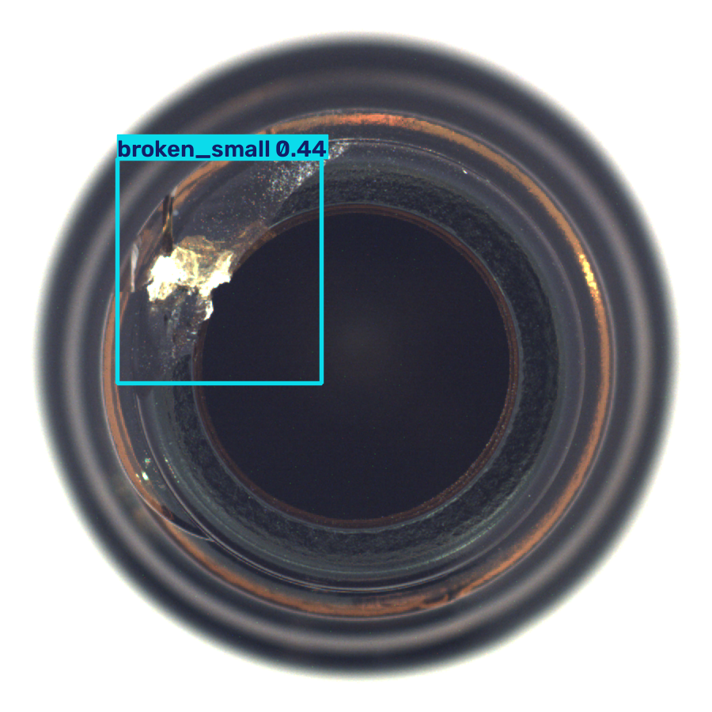
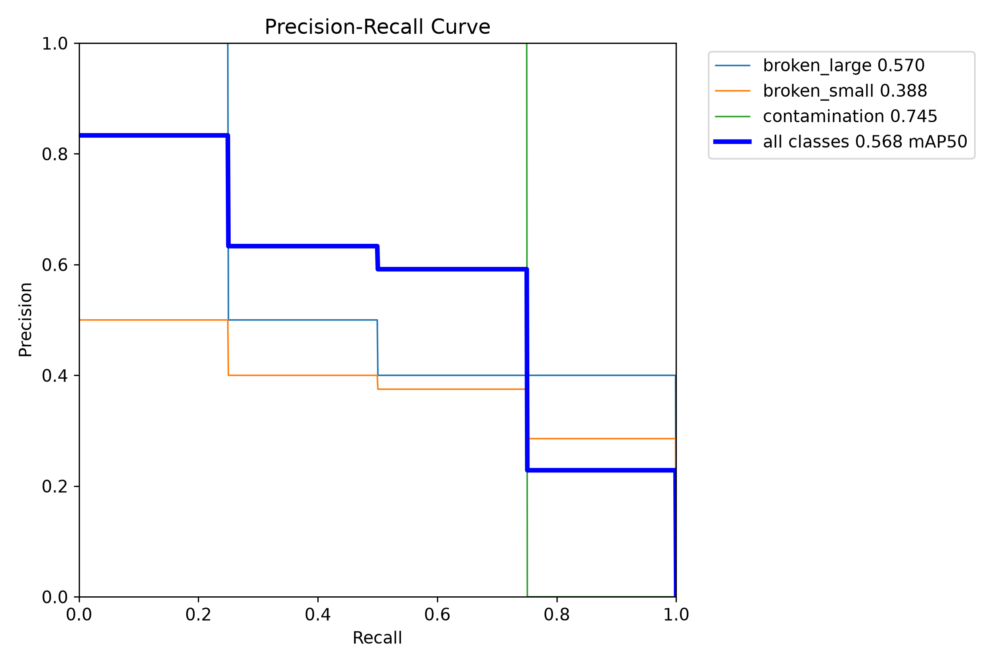

# 基于改进 YOLOv8 的工业表面缺陷检测系统

完整可运行工程：MVTec AD `bottle` 类别 → YOLO 数据集 → 改进 YOLOv8（**CBAM 注意力 + WIoU 损失**）→ 训练 / 评估 / 图像检测界面。

本仓库已内置训练好的权重 `outputs/best.pt`（约 6 MB），克隆后可直接跑推理和界面，不必先训练。

## 效果预览

| 检测输出（标签上是类别与置信度） | 验证集 PR 曲线 |
| :---: | :---: |
|  |  |

固定验证集 32 张（12 缺陷 + 20 正常）上的指标：**mAP@0.5 = 0.5676**，mAP@0.5:0.95 = 0.3080，Precision 0.5571，Recall 0.5633。

## 改进点

1. **CBAM 注意力**：通过 `src/modules.py` 的 `apply_cbam_patch()` 在运行时为所有 C2f 块加入通道 + 空间注意力（`src/attention.py`），不改动 Ultralytics 官方 YAML 解析逻辑，增强对破损、污渍等局部异常的表征。
2. **WIoU 损失**：用 WIoU v1 替换默认 CIoU 的框回归损失（`src/loss.py`），对定位好的样本降低惩罚、聚焦难样本。
3. **数据策略**：把 MVTec 像素级 mask 转成 YOLO 框，分层划分 train/val，并加入正常样本作负样本（`scripts/prepare_dataset.py`）。

## 1. 环境

推荐 Python 3.10/3.11（Python 3.13 可能缺少部分 wheel）：

```bash
pip install -r requirements.txt
```

GPU 用户请按 CUDA 版本到 [PyTorch 官网](https://pytorch.org/get-started/locally/) 选择对应的 torch 安装命令。

## 2. 数据集

官方完整包约 5.3 GB。若只需要本项目的 `bottle` 类别，可直接下载开源镜像中的子集（约 180 MB）：

```bash
python scripts/download_bottle.py --out data/mvtec_anomaly_detection
```

也可以到 [MVTec AD 官网](https://www.mvtec.com/company/research/datasets/mvtec-ad) 填表下载完整包。解压后目录结构应为：

```
data/mvtec_anomaly_detection/
├── bottle/
│   ├── train/good/
│   ├── test/good/
│   ├── test/broken_large/ ...
│   └── ground_truth/broken_large/ ...
├── cable/ ...
```

> 数据集采用 CC BY-NC-SA 4.0，仅限非商业研究/教学使用；论文请引用 Bergmann et al., CVPR 2019。

## 3. 生成 YOLO 数据集

```bash
python scripts/prepare_dataset.py \
  --mvtec-root data/mvtec_anomaly_detection \
  --category bottle \
  --out data/yolo_bottle
```

输出包含 `images/train`、`labels/train`、`images/val`、`labels/val`、`data.yaml`、`dataset_info.json`。
`bottle` 转换后共 63 张缺陷图（训练 51 + 验证 12），训练集另配 209 张正常图作负样本，验证集 20 张正常图；标签由 mask 的连通域外接框生成。

## 4. 训练

```bash
python scripts/build_model_yaml.py --out configs/yolov8n_cbam.yaml --nc 3

python scripts/train.py \
  --data-root data/yolo_bottle \
  --model-yaml configs/yolov8n_cbam.yaml \
  --epochs 120 --imgsz 640 --batch 16 --device 0
```

- CPU 训练建议加 `--imgsz 416 --batch 8 --no-amp`（本项目在 CPU 上用这组参数约 40 秒/epoch）。
- `--device cpu` 可改用 CPU。
- `--no-cbam` / `--no-wiou` 分别关闭 CBAM / WIoU，用于消融实验。
- `--no-pretrained` 从随机初始化训练（不推荐，样本较少）。
- 评估/推理无 CBAM 的消融权重时，设置环境变量 `DEFECT_NO_CBAM=1`。
- 训练完成后最佳权重复制到 `outputs/best.pt`。

### 继续提升精度

当前只有 51 张缺陷训练图，是 mAP 偏低的主要原因。按投入从低到高：

1. **先扩充现有缺陷图**（无需新采集）：`python scripts/augment_defects.py --src data/yolo_bottle --out data/yolo_bottle_aug`，会把每张缺陷图生成水平翻转、垂直翻转、90°旋转、亮度变化 4 个版本（框坐标同步变换），缺陷训练图从 51 张扩到 255 张，然后用 `--data-root data/yolo_bottle_aug` 重新训练。
2. **真实采集**：每类缺陷至少 200~300 张，覆盖不同位置、大小、光照，并按生产批次划分 train/val，避免泄漏。
3. **主动学习**：用当前模型跑未标注图，挑置信度 0.1~0.4 的不确定样本人工标注，迭代补训。
4. **训练侧**：换 `yolov8s.pt` 预训练权重、`--imgsz 640`、更长 epochs、5 折交叉验证；推理时开 TTA。
5. **换思路**：如果只需要判“有无缺陷”而不分类，可用 PatchCore/EfficientAD 无监督异常检测，只靠 209 张正常图训练，MVTec bottle 上通常能达到很高 AUROC。

### 消融实验

```bash
# Baseline: YOLOv8n
python scripts/train.py --data-root data/yolo_bottle --no-cbam --no-wiou --name baseline

# 仅 CBAM
python scripts/train.py --data-root data/yolo_bottle --no-wiou --name cbam_only

# 仅 WIoU
python scripts/train.py --data-root data/yolo_bottle --no-cbam --name wiou_only

# 完整改进（默认）
python scripts/train.py --data-root data/yolo_bottle --name full_cbam_wiou
```

四组实验的 mAP 可从各自 `outputs/runs/<name>/results.csv` 或 `outputs/evaluation/report.md` 汇总到论文表格。

## 5. 评估

```bash
python scripts/evaluate.py --weights outputs/best.pt \
  --data-yaml data/yolo_bottle/data.yaml
```

结果写入 `outputs/evaluation/metrics.json`、`report.md` 以及混淆矩阵、PR 曲线图。

### 本次实跑结果（MVTec AD bottle，CPU）

数据子集来自 Hugging Face 镜像 `foersben/mvtec-ad` 的 `bottle/` 目录（357 个文件，约 180 MB），由 `scripts/download_bottle.py` 下载。验证集固定为 12 张缺陷图 + 20 张正常图。

| 配置 | 缺陷训练图 | mAP@0.5 | mAP@0.5:0.95 |
| --- | ---: | ---: | ---: |
| CBAM + CIoU | 51 | 0.0987 | 0.0471 |
| CBAM + WIoU（原始样本） | 51 | 0.1035 | 0.0383 |
| **CBAM + WIoU + 数据增强（最终 `outputs/best.pt`）** | **255** | **0.5676** | **0.3080** |

增强方案见 `scripts/augment_defects.py`：对每张缺陷图做水平翻转、垂直翻转、90°旋转、亮度变化，框坐标同步变换，缺陷图 51→255 张。最终模型 Precision=0.5571、Recall=0.5633；`broken_large` mAP@0.5:0.95=0.3339、`broken_small`=0.1623、`contamination`=0.4279。旧权重保留为 `outputs/best_original.pt` 供对比。

进一步提升仍需真实采集样本（每类 200~300 张）；如果只判“有无缺陷”，可改用 PatchCore 等无监督方法。当前界面建议置信度阈值 0.25 左右。

## 6. 检测界面 / 命令行推理

```bash
streamlit run app/app.py
```

界面采用统一的 DefectVision 设计系统（`app/design.py`），包含四个页面：**检测工作台**、**模型配置**、**数据集概览**、**使用指南**。检测工作台覆盖加载中、未上传、未检测、检测成功、无缺陷、错误等状态；侧边栏导航、按钮、上传区与表格均有悬停、聚焦和选中反馈，并适配窄屏布局。检测逻辑仍调用 `scripts/predict.py`，接口与数据流未变。

或命令行：

```bash
python scripts/predict.py --weights outputs/best.pt \
  --source data/yolo_bottle/images/val --out outputs/predictions
```

未命中时不会返回空值：界面显示 `产品完好，没有缺陷` 并给出一行汇总表；命令行输出 `没有缺陷，产品完好`。检测到缺陷时仍按原格式输出类别、置信度和坐标。

检测到任何破损或污染时，结果表中的类别与状态条统一以红色报错样式显示；未命中时保持绿色成功提示。检测框仍使用 Ultralytics 默认配色。

## 目录结构

```
defect_detection/
├── configs/          # 数据配置、自动生成的模型 YAML
├── scripts/          # 数据转换 / 训练 / 评估 / 推理
├── src/              # CBAM、C2fCBAM、WIoU 损失
├── app/              # Streamlit 界面
├── data/             # 原始数据与生成的 YOLO 数据
├── outputs/          # 权重、训练日志、评估结果
└── tests/            # 单元测试
```

## 常见问题

- **状态字典含 attention.* 键导致加载失败**：推理/评估脚本会自动打上 CBAM 补丁；若自行调用 YOLO，请先 `from src.modules import apply_cbam_patch; apply_cbam_patch()`。
- **Windows 多进程报错**：训练默认 `workers=0`，无需改动。
- **显存不足**：把 `--batch` 降到 4/8，`--imgsz` 降到 416/640。
- **mAP 偏低**：确认数据是从 mask 正确转换而来；可增大 `--epochs`，或换 `metal_nut` 类别（缺陷图更多）重新走一遍流程。
